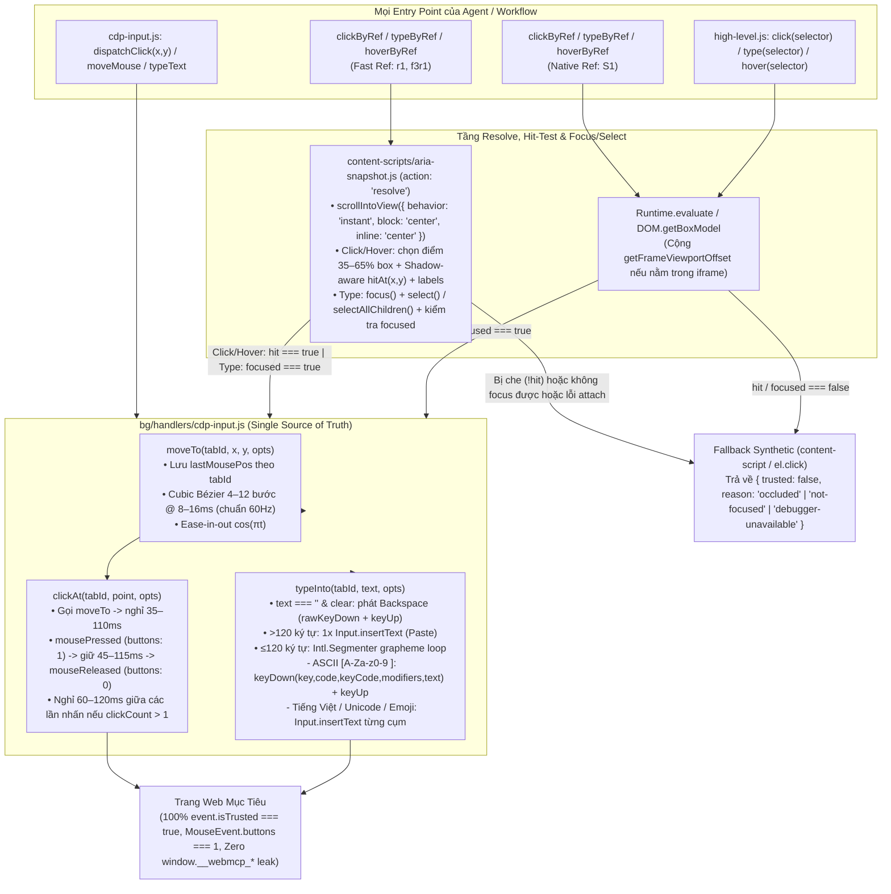

# Kế Hoạch Triển Khai (Ponytail Edition — Opus 5.5 High Approved): Human Behavior Input Unification & Stealth Hygiene

> [!IMPORTANT]
> **Trạng thái thẩm định**: **`APPROVE WITH MINOR TWEAKS` (Đã tích hợp toàn bộ 8 Tweaks `T1`–`T8` từ Claude Opus 5.5 High & Gemini 4 Argon High)**.
> 1. **Sửa đúng gốc nơi mọi caller đi qua (Root-Cause Routing)**: Nâng cấp trực tiếp 3 primitive hạt nhân trong [`bg/handlers/cdp-input.js`](file:///Users/ttcenter/Desktop/VIBE_CODE/webmcp-automation-kit/packages/webmcp-browser-kit/webmcp-extension/dist/bg/handlers/cdp-input.js) (`moveTo`, `clickAt`, `typeInto`) và **điều hướng toàn bộ `clickByRef`, `typeByRef`, `hoverByRef`, `click(selector)`, `type(selector)`, `dispatchClick`, `typeText`, `moveMouse`, `hover`** về chung một đường ống CDP `Input.*` (`event.isTrusted === true`).
> 2. **Cắt bỏ triệt để Over-engineering & Bẫy gây hại (YAGNI)**:
>    - **Cắt 100% Hạng mục sửa `Local State` & `DevToolsActivePort`**: Trang web không đọc được `Local State -> intl.app_locale`. Đặc biệt, thêm `'DevToolsActivePort'` vào `LOCK_FILES` sẽ làm [`isProfileLocked()`](file:///Users/ttcenter/Desktop/VIBE_CODE/webmcp-automation-kit/packages/webmcp-browser-kit/chrome-launcher/launcher.js#L99-L103) luôn trả về `true` khi Chrome đã tắt, gây treo `launchChrome`.
>    - **Cắt chế độ Typo 2–3% + `Backspace`**: Phá hỏng ô nhập OTP (tự nhảy focus), làm loạn dropdown autocomplete, bắn request thừa trên ô search debounce và làm sai password.
>    - **Không thay thế mù quáng `Input.insertText` cho mọi chuỗi**: `Input.insertText` bản chất là IME commit của CDP nên **vẫn có `isTrusted: true`**. Gõ từng phím (`dispatchKeyEvent`) chỉ dùng cho ký tự ASCII trên chuỗi ngắn ($\le 120$ ký tự); ký tự tiếng Việt có dấu / Unicode / Emoji dùng `insertText` theo nhịp gõ; chuỗi dài ($> 120$ ký tự) dùng 1 lệnh `insertText` (như hành vi paste tự nhiên).

---

## 1. Sơ Đồ Kiến Trúc Luồng Input Hợp Nhất (Unified Trusted Input Pipeline)



---

## 2. Chi Tiết Kỹ Thuật Từng Hạng Mục (Đã tích hợp Tweaks `T1`–`T8`)

### Hạng Mục 1: Nâng Cấp Hạt Nhân `bg/handlers/cdp-input.js` (`T2`, `T3`, `T7`)
* **File mục tiêu**: [`packages/webmcp-browser-kit/webmcp-extension/dist/bg/handlers/cdp-input.js`](file:///Users/ttcenter/Desktop/VIBE_CODE/webmcp-automation-kit/packages/webmcp-browser-kit/webmcp-extension/dist/bg/handlers/cdp-input.js)
* **Thiết kế 3 Primitive xuất khẩu (`export`) dùng chung toàn Extension**:
  1. **`moveTo(tabId, x, y, { human = true, steps } = {})`**:
     - Lấy điểm xuất phát `from = lastMousePos.get(tabId)` (dọn dẹp `lastMousePos` khi tab đóng hoặc debugger detach qua `onTabDetached`).
     - Nếu `human && from && Math.hypot(x - from.x, y - from.y) > 4`:
       - Tạo đường cong Cubic Bézier bậc 3 với 2 điểm điều khiển $P_1, P_2$ lệch vuông góc ngẫu nhiên $[-25\%, +25\%]$ khoảng cách $d$.
       - Số bước nội suy tối ưu theo tần số màn hình 60Hz: `const n = steps || Math.max(4, Math.min(12, Math.round(d / 45)));`
       - Gia tốc thời gian Ease-in-out: $t = \frac{1 - \cos(\pi \cdot i / n)}{2}$, nghỉ `rnd(8, 16)` ms giữa các bước, phát `mouseMoved` với `buttons: 0`.
     - Phát lệnh `mouseMoved` cuối cùng tại đúng `(x, y)` (`buttons: 0`) và cập nhật `lastMousePos.set(tabId, { x, y })`.
  2. **`clickAt(tabId, target, { button = 'left', clickCount = 1, human = true } = {})`** (**`T1`, `T7`**):
     - Nếu `target` đã có toạ độ điểm đích đã kiểm chứng hit-test (`target.x`, `target.y` khi không có `width/height` hoặc đã có `target.pointX, target.pointY`), dùng đúng điểm đó. Nếu truyền hộp `{ x, y, width, height }` chưa chọn điểm, lấy ngẫu nhiên trong vùng $35\%\text{--}65\%$.
     - Gọi `await moveTo(tabId, x, y, { human })`.
     - Nếu `human`: dừng nhẹ trước khi nhấn `rnd(35, 110)` ms.
     - Tính `buttons = { left: 1, right: 2, middle: 4 }[button] ?? 1`.
     - Lặp `for (let c = 1; c <= clickCount; c++)`:
       - Phát `mousePressed` với `{ x, y, button, buttons, clickCount: c }`.
       - Nếu `human`: giữ chuột `rnd(45, 115)` ms.
       - Phát `mouseReleased` với `{ x, y, button, buttons: 0, clickCount: c }`.
       - **(`T7`) Khoảng nghỉ giữa double/triple click**: `if (human && c < clickCount) await sleep(rnd(60, 120));`.
  3. **`typeInto(tabId, text, { human = true, clearEmptyWithBackspace = false } = {})`** (**`T2`, `T3`**):
     - **(`T3`) Xử lý xoá trắng khi `text === ''`**: Nếu `text === ''`:
       - Nếu `clearEmptyWithBackspace`: phát cặp `rawKeyDown` + `keyUp` cho phím `Backspace` (`key: 'Backspace', code: 'Backspace', windowsVirtualKeyCode: 8, nativeVirtualKeyCode: 8`) để xoá sạch phần văn bản vừa được bôi đen với `isTrusted: true`.
       - Ngược lại return ngay.
     - Nếu `!human || text.length > 120`: Gọi 1 lần `sendCDPCommand(tabId, 'Input.insertText', { text })`.
     - Nếu `human && text.length <= 120`:
       - Duyệt từng grapheme qua `new Intl.Segmenter('vi', { granularity: 'grapheme' }).segment(text)`:
       - **(`T2`) Đầy đủ metadata phím cho ASCII `/^[A-Za-z0-9 ]$/`**:
         ```js
         const up = ch.toUpperCase();
         const code = ch === ' ' ? 'Space' : /\d/.test(ch) ? `Digit${ch}` : `Key${up}`;
         const keyCode = up.charCodeAt(0);
         const modifiers = /[A-Z]/.test(ch) ? 8 : 0;
         await sendCDPCommand(tabId, 'Input.dispatchKeyEvent', {
           type: 'keyDown', key: ch, code, text: ch, unmodifiedText: ch.toLowerCase(),
           windowsVirtualKeyCode: keyCode, nativeVirtualKeyCode: keyCode, modifiers,
         });
         await sendCDPCommand(tabId, 'Input.dispatchKeyEvent', {
           type: 'keyUp', key: ch, code,
           windowsVirtualKeyCode: keyCode, nativeVirtualKeyCode: keyCode, modifiers,
         });
         ```
       - Nếu là ký tự tiếng Việt có dấu, dấu câu hoặc Emoji: phát `Input.insertText({ text: ch })`.
       - Nhịp nghỉ giữa các ký tự: `rnd(110, 210)` ms sau khoảng trắng/dấu câu `[\s.,!?;:]`, và `rnd(35, 95)` ms cho ký tự thường.

---

### Hạng Mục 2: Hợp Nhất `clickByRef`, `typeByRef`, `hoverByRef` và `high-level.js` (`T1`, `T4`, `T6`, `T7`)
* **File mục tiêu**:
  - [`packages/webmcp-browser-kit/webmcp-extension/dist/content-scripts/aria-snapshot.js`](file:///Users/ttcenter/Desktop/VIBE_CODE/webmcp-automation-kit/packages/webmcp-browser-kit/webmcp-extension/dist/content-scripts/aria-snapshot.js)
  - [`packages/webmcp-browser-kit/webmcp-extension/dist/bg/handlers/aria-snapshot.js`](file:///Users/ttcenter/Desktop/VIBE_CODE/webmcp-automation-kit/packages/webmcp-browser-kit/webmcp-extension/dist/bg/handlers/aria-snapshot.js)
  - [`packages/webmcp-browser-kit/webmcp-extension/dist/bg/handlers/high-level.js`](file:///Users/ttcenter/Desktop/VIBE_CODE/webmcp-automation-kit/packages/webmcp-browser-kit/webmcp-extension/dist/bg/handlers/high-level.js)
* **Các quy tắc bất biến (`T1`, `T4`, `T6`, `T7`)**:
  1. **(`T7`) Cuộn tức thì trước khi đo**: Luôn dùng `element.scrollIntoView({ behavior: 'instant', block: 'center', inline: 'center' })` để không bị lệch `bounds` trên các trang có CSS `scroll-behavior: smooth`.
  2. **(`T1`) Hit-Test chuẩn Shadow DOM & `<label>`, bỏ `hitEl.contains(element)`**:
     - Không dùng `hitEl.contains(element)` (vì nếu trúng `body` hoặc wrapper cha, `hitEl.contains(element)` sẽ báo `true` giả).
     - Dùng `getRootNode()` để xuyên Shadow DOM và hỗ trợ `<label>` của custom checkbox/radio:
       ```js
       const root = typeof element.getRootNode === 'function' ? element.getRootNode() : document;
       const docOrRoot = typeof root?.elementFromPoint === 'function' ? root : document;
       const hitAt = (px, py) => {
         if (typeof docOrRoot.elementFromPoint !== 'function') return false;
         const h = docOrRoot.elementFromPoint(px, py);
         if (!h) return false;
         if (h === element || (typeof element.contains === 'function' && element.contains(h))) return true;
         const labels = element.labels ? Array.from(element.labels) : [];
         return labels.some((l) => l === h || (typeof l.contains === 'function' && l.contains(h)));
       };
       ```
     - Thử điểm ngẫu nhiên `(randX, randY)` trong vùng $35\%\text{--}65\%$ của `bounds` trước; nếu trượt, thử tại tâm `(centerX, centerY)`. Trả về **đúng toạ độ `(targetX, targetY)` đã pass `hitAt`** để `clickAt` click chính xác vào điểm đó.
  3. **(`T4`, `T6`) Bất biến thứ tự Focus + Select cho `typeByRef` & Gate bằng `focused`**:
     - **Tuyệt đối KHÔNG gọi `clickAt` sau khi đã `select()`** (vì click chuột sẽ làm mất vùng bôi đen và đặt con trỏ vào giữa chữ cũ).
     - Trong `resolve({ prepareType: true })`:
       - Gọi `element.focus()`.
       - Nếu `params.clear !== false`:
         - Với `input` / `textarea`: `if (typeof element.select === 'function') element.select();`
         - **(`T4`) Với `contentEditable`**: `else if (element.isContentEditable) element.ownerDocument?.getSelection?.()?.selectAllChildren(element);`
       - **(`T6`) Kiểm tra `focused`**:
         ```js
         const active = docOrRoot.activeElement || document.activeElement;
         const focused = active === element || (typeof element.contains === 'function' && element.contains(active));
         ```
       - `typeByRef` chỉ cần `focused === true` (không bị chặn oan bởi overlay trong suốt) là đi thẳng vào `typeInto(tabId, text, { human: params.human !== false, clearEmptyWithBackspace: text === '' && params.clear !== false })`!

---

### Hạng Mục 3: Đóng Gói `waitForPageStable` (`T5`) & Vệ Sinh Nhẹ
* **File mục tiêu**:
  - [`packages/webmcp-browser-kit/webmcp-extension/dist/bg/handlers/page-stability.js`](file:///Users/ttcenter/Desktop/VIBE_CODE/webmcp-automation-kit/packages/webmcp-browser-kit/webmcp-extension/dist/bg/handlers/page-stability.js)
  - [`packages/webmcp-browser-kit/webmcp-extension/dist/bg/handlers/full-control.js`](file:///Users/ttcenter/Desktop/VIBE_CODE/webmcp-automation-kit/packages/webmcp-browser-kit/webmcp-extension/dist/bg/handlers/full-control.js)
  - [`packages/webmcp-browser-kit/chrome-launcher/launcher.js`](file:///Users/ttcenter/Desktop/VIBE_CODE/webmcp-automation-kit/packages/webmcp-browser-kit/chrome-launcher/launcher.js)
* **Chi tiết thực hiện**:
  1. **(`T5`) `waitForPageStable` trong 1 `new Promise` closure cục bộ (`page-stability.js`)**:
     - Không tạo bất kỳ biến `window.__webmcp_*` nào trên `window`.
     - Kẹp `const effectiveMaxWaitMs = Math.min(maxWaitMs, 25000)` để luôn nhỏ hơn `CDP_TIMEOUT_MS` (`30000ms`).
     - Bên trong `new Promise`, cả nhánh đạt `stable` lẫn nhánh `setTimeout(effectiveMaxWaitMs)` đều gọi `observer.disconnect()`, `clearInterval(pollTimer)` và `clearTimeout(timeoutTimer)`.
     - Nếu `evaluateInTab` ném lỗi huỷ ngữ cảnh do trang vừa chuyển hướng (`Execution context was destroyed` / `Cannot find context`), bắt lỗi, chờ `150ms` và thử lại 1 lần với phần thời gian còn lại để đảm bảo trang mới thực sự ổn định sau khi click chuyển trang.
  2. **Chuẩn hoá nhẹ `partitionKey` (`full-control.js`)**:
     - Chỉ chuyển đổi khi `typeof partitionKey === 'string'` $\rightarrow$ `{ topLevelSite: partitionKey }`, giữ nguyên 100% nếu caller truyền vào object (`hasCrossSiteAncestors` của caller không bị ghi đè).
  3. **Ẩn thanh cảnh báo Debugger (`launcher.js`)**:
     - Thêm `'--silent-debugger-extension-api'` (cờ chính thức trong `chrome_switches.cc`, không nằm trong `bad_flags_prompt.cc`) vào `baseArgs`.

---

## 3. Kế Hoạch Kiểm Thử (`T8` — Bắt Buộc Theo `/ponytail`)
1. **Giữ pass 100% bộ unit test hiện có**: `npm test` trong `packages/webmcp-browser-kit` (46 file test).
2. **Bổ sung bài test chuyên biệt cho luồng CDP Input & ARIA Trusted Routing**:
   - Kiểm tra `clickAt`: chuỗi `mouseMoved` (`buttons: 0`) theo đường cong $\rightarrow$ `mousePressed` (`buttons: 1`) $\rightarrow$ `mouseReleased` (`buttons: 0`), và double-click (`clickCount: 2`) phát đủ 2 cặp.
   - Kiểm tra `typeInto`: chuỗi ngắn `"Ab"` phát `keyDown`/`keyUp` có đủ `key`, `code`, `windowsVirtualKeyCode`, `modifiers: 8` cho chữ hoa; ký tự tiếng Việt `"ờ"` phát `Input.insertText`; chuỗi $> 120$ ký tự phát đúng 1 lệnh `Input.insertText`; chuỗi rỗng `""` kèm `clearEmptyWithBackspace: true` phát `Backspace`.
   - Kiểm tra `clickByRef` & `typeByRef` khi `elementFromPoint` / `activeElement` khớp: đi đúng vào nhánh CDP (`source: 'cdp', trusted: true`), và khi bị che khuất (`!hit`) thì fallback sang nhánh content-script (`trusted: false, reason: 'occluded'`).
   - Kiểm tra `waitForPageStable`: xác nhận `'__webmcp_stability_observer' in window === false`.
