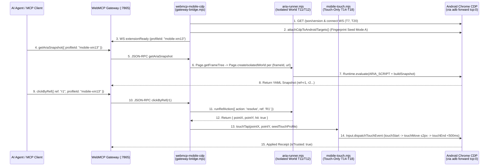

# Kế Hoạch Thiết Kế & Triển Khai: Zero-Extension Android Chrome Automation Qua ADB CDP
# (`@gyga-browser/webmcp-browser-automation-kit` — Thư Mục Độc Lập `webmcp-mobile-cdp/`)

**Ngày ban hành**: `2026-10-29`  
**Trạng thái**: `PROPOSED — Đã thẩm định thiết kế bởi Claude Opus 5.5 High & Gemini 4 Argon dưới lăng kính /ponytail`  
**Mục tiêu**: `/Users/ttcenter/Desktop/VIBE_CODE/webmcp-automation-kit/packages/webmcp-browser-kit/webmcp-mobile-cdp/`  
**Công cụ thẩm định**: Claude Opus 5.5 High (`claude-opus-4-7 --effort high`) + Gemini 4 Argon Subagents  
**Phạm vi**: Tự động hóa trình duyệt Chrome trên điện thoại Android qua cầu nối ADB CDP mà **không cần cài đặt Chrome Extension**, tương thích 100% với WebMCP Gateway (`:7865`) và `@webmcp/fingerprint-kit/src/mobile`.

---

## 1. Tóm Tắt Đề Xuất (Executive Proposal) & Triết Lý `/ponytail`

### 1.1. Tại Sao Dùng Zero-Extension CDP Bridge Thay Vì Cài Extension Lên Điện Thoại?
1. **Chrome chính chủ trên Android (`com.android.chrome` / `com.chrome.dev`) khóa cài đặt Extension**: Các trình duyệt nhân Chromium bên thứ ba cho cài `.crx` (Kiwi, Lemur, Yandex) đều lộ dấu hiệu bất thường trước Cloudflare/DataDome.
2. **Đường ống CDP qua ADB sạch tuyệt đối (Zero `chrome-extension://` Footprint)**:
   - Trên Desktop, `webmcp-extension` kết nối vào WebMCP Gateway (`ws://127.0.0.1:7865`) bằng thông điệp JSON-RPC `extensionReady` và thực thi lệnh qua `chrome.debugger` (tức CDP) + Content Script `aria-snapshot.js`.
   - Trên Android, khi đã mở đường ống `adb -s <serial> forward tcp:0 localabstract:chrome_devtools_remote`, ta có quyền truy cập **CDP trực tiếp** từ máy chủ điều phối!
   - Do đó, module `webmcp-mobile-cdp/` đóng vai trò là một **"Virtual Extension Bridge"**:
     - Một đầu kết nối WebSocket tới WebMCP Gateway (`ws://127.0.0.1:7865`, đăng ký `profileId: "mobile-<device>"`).
     - Đầu kia kết nối WebSocket tới CDP của Chrome trên điện thoại (`ws://127.0.0.1:<localPort>/devtools/...`).
     - **Zero code change** trên `server/gateway_server.js` và `server/mcp_server.mjs`! AI Agent gọi `getAriaSnapshot`, `clickByRef`, `typeByRef`, `scroll`, `navigate` trên Chrome điện thoại giống hệt 100% như trên Desktop.

---

## 2. Các Chốt Chặn Kỹ Thuật Từ Claude Opus 5.5 High (`B3`–`B5`, `T7`–`T18`, `T20`)

| Mã | Vấn đề / Bẫy ngầm trên Android Chrome CDP | Quyết định thiết kế trong Plan |
| :--- | :--- | :--- |
| **`B3`** | Đọc trực tiếp `../webmcp-extension/dist/content-scripts/aria-snapshot.js` không có kiểm tra toàn vẹn dễ vỡ ngầm nếu Extension đổi cấu trúc. | Dùng contract rõ ràng (`webmcp-extension/dist/shared/aria-snapshot.iife.js` hoặc kiểm tra SHA-256 / export contract `__WEBMCP_FAST_ARIA_API__` khi khởi tạo `aria-runner.mjs`). |
| **`B4` & `T8`** | Android Chrome không có `/devtools/browser/<uuid>` kiểu desktop headful; định tuyến session con bắt buộc qua `Target.setAutoAttach({ flatten: true })`. | Lấy `webSocketDebuggerUrl` từ `GET /json/version` (`T7`), bật `Target.setAutoAttach({ autoAttach: true, waitForDebuggerOnStart: true, flatten: true })` (`T8`) và định tuyến mọi lệnh theo `sessionId`. |
| **`B5`** | Ôm đồm 13+ methods của Gateway ngay ở v1 gây phình code. | **Phase 1 (P0 Core)** chỉ ship **6 methods thiết yếu nhất**: `listTabs`, `navigate`, `getAriaSnapshot`, `clickByRef`, `typeByRef`, `scroll`. Các method phụ (`evaluateJS`, `screenshot`, `waitForSelector`, `newTab`, `closeTab`, `activateTab`, `batch`) xếp vào **Phase 2 (P1)**. |
| **`T11` & `T12`** | `executionContextId` của `Page.createIsolatedWorld` bị hủy ngay khi tab chuyển trang (`Page.frameNavigated` / `Runtime.executionContextDestroyed`), và `grantUniversalAccess: true` chạm sang cross-origin iframe sẽ ném lỗi bảo mật. | `aria-runner.mjs` lắng nghe cả `Page.frameNavigated` và `Runtime.executionContextDestroyed`, duyệt cây frame qua `Page.getFrameTree` (`T12`) và tạo Isolated World riêng cho từng `(frameId, url)` (`T11`). |
| **`T13`** | Bộ quản lý bộ nhớ Android (**LMK — Low Memory Killer**) có thể giết tiến trình tab chạy nền bất cứ lúc nào. | Lắng nghe `Target.targetCrashed` và `Target.targetDestroyed`, tự động dọn session chết và reconnect khi tab được kích hoạt lại. |
| **`T14` & `T15`** | Trộn lẫn `Input.dispatchTouchEvent` và `Input.dispatchMouseEvent` làm sự kiện `click` bị bắn đúp (double-fire). Ngoài ra, thiếu `touchEnd` hoặc lệch quá `tap-slop (~15px)` sẽ biến tap thành drag. | **Single-channel Touch-Only (`T15`)**: Chỉ dùng `Input.dispatchTouchEvent` trên mobile. `clickByRef` bắt buộc phát chuỗi hoàn chỉnh `touchStart` $\rightarrow$ (tuỳ chọn 1 bước `touchMove` $\le 2\text{px}$) $\rightarrow$ `touchEnd` tại cùng toạ độ trong `< 500ms` (`T14`). |
| **`T16`** | `Input.synthesizeScrollGesture` dùng physics engine có quán tính (fling inertia) nên kết quả cuộn không đơn định giữa các lần chạy. | Mặc định `scroll` dùng chuỗi manual `touchStart` $\rightarrow$ $N$ bước `touchMove` tuyến tính/ease-out $\rightarrow$ giữ nhẹ rồi `touchEnd` (triệt tiêu quán tính trượt quá đà). Chỉ gọi `Input.synthesizeScrollGesture` khi truyền cờ `{ realistic: true }`. |
| **`T17`** | `Input.insertText` bỏ qua IME composition, còn `dispatchKeyEvent` chậm hơn với văn bản dài. | Mặc định `typeByRef` dùng `Input.insertText` (nhanh, chuẩn tiếng Việt Unicode và React controlled input, `isTrusted: true`). Hỗ trợ tuỳ chọn `{ imeMode: true }` bắn chuỗi `Input.dispatchKeyEvent` cho các ô autocomplete bắt buộc `keydown`/`keyup`. |
| **`T18`** | Các hệ thống chống bot (DataDome, PerimeterX) kiểm tra `TouchEvent.touches[0].radiusX` và `force`. | Nhận `touchProfile` từ `@webmcp/fingerprint-kit/src/mobile` để gán `radiusX/radiusY ∈ [10, 20]` và `force ∈ [0.1, 0.9]` biến thiên nhẹ quanh hạt giống `profile.seed`. |
| **`T20`** | Đụng độ cổng khi điều khiển nhiều điện thoại song song. | Dùng `adb -s <serial> forward tcp:0 localabstract:chrome_devtools_remote` và lưu ánh xạ `{ deviceSerial -> localPort, profileId }` vào `.webmcp-mobile-meta.json`. |

---

## 3. Kiến Trúc Thư Mục Độc Lập `webmcp-mobile-cdp/`

Đặt tại thư mục độc lập ngang hàng với `webmcp-extension/`, hoàn toàn tách biệt với code Desktop:

```text
packages/webmcp-browser-kit/
├── webmcp-mobile-cdp/                             # [THƯ MỤC MỚI — CÔ LẬP 100%]
│   ├── index.mjs                                  # Barrel export & CLI runner (~50 LOC)
│   ├── adb-forward.mjs                            # adb forward tcp:0, /json/version & /json/list discovery (~90 LOC)
│   ├── cdp-client.mjs                             # WebSocket CDP client (flatten:true, LMK crash recovery T13) (~140 LOC)
│   ├── aria-runner.mjs                            # IsolatedWorld per-(frameId,url) nạp aria-snapshot (~130 LOC)
│   ├── mobile-touch.mjs                           # Touch-only tap (T14,T15,T18), deterministic scroll (T16), type (T17) (~140 LOC)
│   └── gateway-bridge.mjs                         # WS client nối Gateway :7865 ('extensionReady'), xử lý 6 core tools P0 (~180 LOC)
└── tests/
    └── mobile-cdp/                                # [THƯ MỤC TEST MỚI]
        ├── cdp-client-and-lmk.test.mjs            # Test T7, T8 (flatten:true), T13 (LMK crash recovery)
        ├── aria-runner-isolated-world.test.mjs    # Test B3 (checksum), T11 (frameNavigated cache invalidate), T12 (per-frame)
        ├── mobile-touch.test.mjs                  # Test T14 (<500ms tap), T15 (touch-only), T16 (scroll), T17 (insertText/IME), T18
        └── gateway-bridge.test.mjs                # Test B5 (6 P0 methods end-to-end với mock Gateway)
```

---

## 4. Sơ Đồ Luồng Điều Khiển (End-to-End Mobile CDP Flow)



---

## 5. Kế Hoạch Triển Khai Chi Tiết (Implementation Plan)

### Phase 1 (P0): Hạ Tầng Kết Nối ADB & CDP Client (`adb-forward.mjs` & `cdp-client.mjs`)
1. `adb-forward.mjs`:
   - Gọi `adb -s <serial> forward tcp:0 localabstract:chrome_devtools_remote` (`T20`), lưu `{ deviceSerial, localPort, profileId, updatedAt }` vào `.webmcp-mobile-meta.json`.
   - Cung cấp các hàm gọi HTTP `/json/version`, `/json/list`, `/json/new`, `/json/activate/<id>`, `/json/close/<id>` (`T7`).
2. `cdp-client.mjs`:
   - Kết nối tới `webSocketDebuggerUrl` bằng thư viện `ws` có sẵn trong `package.json`.
   - Hỗ trợ gửi lệnh có `sessionId` phẳng (`Target.setAutoAttach({ autoAttach: true, waitForDebuggerOnStart: true, flatten: true })` theo `T8`).
   - Tự động bắt sự kiện `Target.targetCrashed` và `Target.targetDestroyed` (`T13`) để dọn sạch session cũ và khôi phục kết nối khi tab được mở/reload lại.

### Phase 2 (P0): Isolated World ARIA Snapshot Runner (`aria-runner.mjs`)
1. Nạp script `aria-snapshot.js` kèm kiểm tra toàn vẹn SHA-256 và sự tồn tại của `window.__WEBMCP_FAST_ARIA_API__` (`B3`).
2. Quản lý vòng đời `executionContextId` theo cặp khóa `${frameId}::${frameUrl}` (`T11`):
   - Đăng ký listener `Page.frameNavigated` và `Runtime.executionContextDestroyed` để xóa cache ngay khi trang điều hướng.
   - Duyệt danh sách frame qua `Page.getFrameTree` (`T12`) và gọi `Page.createIsolatedWorld({ frameId, worldName: 'webmcp-mobile-isolated', grantUniversalAccess: true })` riêng cho từng frame, tuyệt đối không truy cập chéo DOM của cross-origin iframe từ main frame.

### Phase 3 (P0): Bộ Phát Sự Kiện Cảm Ứng Thật (`mobile-touch.mjs`)
1. **`touchTap(cdp, x, y, touchProfile)` (`T14`, `T15`, `T18`)**:
   - Tuyệt đối không gọi `Input.dispatchMouseEvent` (`T15`).
   - Tính `radiusX`, `radiusY` ($\in [10, 20]$) và `force` ($\in [0.1, 0.9]$) dựa trên `touchProfile` của `profile.seed` (`T18`).
   - Phát `Input.dispatchTouchEvent` (`type: 'touchStart'`) $\rightarrow$ nghỉ `35–80ms` $\rightarrow$ 1 bước `touchMove` lệch $\le 2\text{px}$ (nhỏ hơn `tap-slop 15px`) $\rightarrow$ nghỉ `20–45ms` $\rightarrow$ `touchEnd` (`touchPoints: []`). Tổng thời gian luôn `< 500ms` (`T14`).
2. **`touchScroll(cdp, { x, y, deltaX, deltaY, realistic = false })` (`T16`)**:
   - Mặc định (`realistic: false`): Thực hiện 6–10 bước `touchMove` nội suy mượt mà rồi giữ nguyên vị trí `60ms` trước khi發 `touchEnd` để triệt tiêu quán tính trượt (deterministic scroll).
   - Khi `realistic: true`: Gọi `Input.synthesizeScrollGesture({ gestureSourceType: 'touch', ... })`.
3. **`touchType(cdp, text, { imeMode = false })` (`T17`)**:
   - Mặc định (`imeMode: false`): Gọi `Input.insertText({ text })`.
   - Khi `imeMode: true`: Duyệt từng ký tự và phát `Input.dispatchKeyEvent` (`keyDown` + `keyUp`).

### Phase 4 (P0): Cầu Nối Gateway 6 Lệnh Cốt Lõi (`gateway-bridge.mjs`) & Phase 5 (P1 Mở Rộng)
1. **Phase 4 (P0 — 6 Core Methods theo `B5`)**:
   - Kết nối `ws://127.0.0.1:7865`, gửi `extensionReady` với `profileId: "mobile-<device>"`.
   - Triển khai 6 handler đầu tiên: `listTabs`, `navigate`, `getAriaSnapshot`, `clickByRef`, `typeByRef`, `scroll`.
   - Tích hợp `attachCdpToAndroidTargets()` từ `@webmcp/fingerprint-kit/src/mobile` ngay khi mở kết nối CDP.
2. **Phase 5 (P1 — 7 Extended Methods)**:
   - Sau khi 6 lệnh P0 đã vượt qua kiểm thử trên thiết bị thật, mở rộng thêm: `newTab`, `closeTab`, `activateTab`, `waitForSelector`, `evaluateJS`, `screenshot`, `batch`.

---

## 6. Danh Sách Kiểm Tra Nghiệm Thu (Definition of Done — DoD Checklists)

> **Hướng dẫn cho AI Agent khi triển khai**: Đánh dấu `[x]` vào từng ô ngay sau khi hoàn thành và chạy pass bài test tương ứng.

### 6.1. DoD Kiến Trúc & Ranh Giới Module (`/ponytail`)
- [ ] **DoD-B1**: Toàn bộ mã nguồn mới nằm trong thư mục độc lập `packages/webmcp-browser-kit/webmcp-mobile-cdp/`, mỗi file `< 250 LOC`, không sửa đổi `server/gateway_server.js` hay `server/mcp_server.mjs`.
- [ ] **DoD-B2 (`B3`)**: `aria-runner.mjs` nạp bundle `aria-snapshot` có kiểm tra checksum / contract `__WEBMCP_FAST_ARIA_API__`, không copy-paste mã nguồn của extension.
- [ ] **DoD-B3 (`B5`)**: Ship gọn 6 lệnh P0 (`listTabs`, `navigate`, `getAriaSnapshot`, `clickByRef`, `typeByRef`, `scroll`) trước, tách 7 lệnh P1 sau cờ hoặc phase riêng.

### 6.2. DoD Cho Kết Nối CDP, Isolated World & Chống Sập LMK (`T7`, `T8`, `T11`–`T13`, `T20`)
- [ ] **DoD-CDP1 (`T7`, `T20`)**: `adb-forward.mjs` dùng `adb -s <serial> forward tcp:0 localabstract:chrome_devtools_remote`, lưu port động vào `.webmcp-mobile-meta.json` và khám phá target qua `/json/version` + `/json/list`.
- [ ] **DoD-CDP2 (`T8`)**: `cdp-client.mjs` bật `Target.setAutoAttach({ autoAttach: true, waitForDebuggerOnStart: true, flatten: true })` và định tuyến chính xác response/event theo `sessionId`.
- [ ] **DoD-CDP3 (`T11`)**: `aria-runner.mjs` lắng nghe `Page.frameNavigated` và `Runtime.executionContextDestroyed`, tự động xóa cache và tạo lại Isolated World theo khóa `(frameId, url)`.
- [ ] **DoD-CDP4 (`T12`)**: Duyệt frame qua `Page.getFrameTree` và khởi tạo Isolated World riêng cho từng frame (không chọc xuyên cross-origin iframe từ main frame).
- [ ] **DoD-CDP5 (`T13`)**: Xử lý `Target.targetCrashed` và `Target.targetDestroyed` (do Android LMK giết tab nền), có bài test giả lập đóng/crashed 10 tab liên tiếp mà không rò rỉ bộ nhớ hay treo tiến trình bridge.

### 6.3. DoD Cho Cảm Ứng & Nhập Liệu Mobile (`T14`–`T18`)
- [ ] **DoD-TCH1 (`T14`)**: `clickByRef` luôn phát đủ chuỗi `touchStart` $\rightarrow$ (`touchMove` $\le 2\text{px}$) $\rightarrow$ `touchEnd` tại cùng tọa độ trong thời gian `< 500ms`.
- [ ] **DoD-TCH2 (`T15`)**: `mobile-touch.mjs` chỉ phát duy nhất kênh Touch (`Input.dispatchTouchEvent`), tuyệt đối không phát kèm `Input.dispatchMouseEvent` gây double-click.
- [ ] **DoD-TCH3 (`T16`)**: `scroll` mặc định dùng chuỗi `touchStart` $\rightarrow$ $N$ bước `touchMove` $\rightarrow$ dừng ngắn $\rightarrow$ `touchEnd` không văng quán tính (deterministic), và hỗ trợ `{ realistic: true }` qua `Input.synthesizeScrollGesture`.
- [ ] **DoD-TCH4 (`T17`)**: `typeByRef` mặc định dùng `Input.insertText` và hỗ trợ tuỳ chọn `{ imeMode: true }` phát chuỗi `Input.dispatchKeyEvent`.
- [ ] **DoD-TCH5 (`T18`)**: Tích hợp `touchProfile` (`radiusX/radiusY ∈ [10, 20]`, `force ∈ [0.1, 0.9]`) biến thiên đơn định theo `profile.seed`.
- [ ] **DoD-TEST1**: Bộ unit test tại `tests/mobile-cdp/*.test.mjs` kiểm chứng toàn bộ các chốt chặn trên và đạt 100% PASS.
